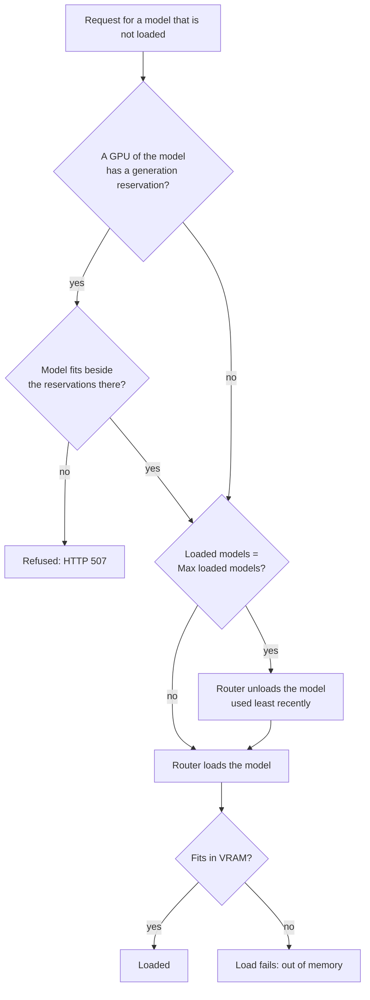
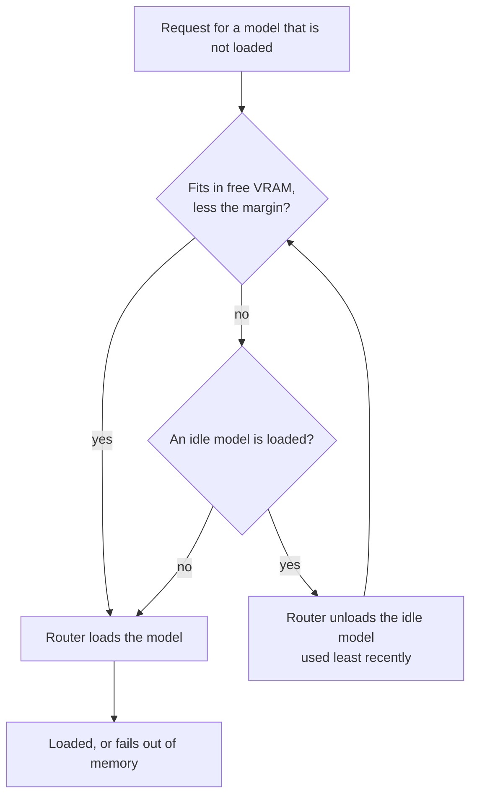
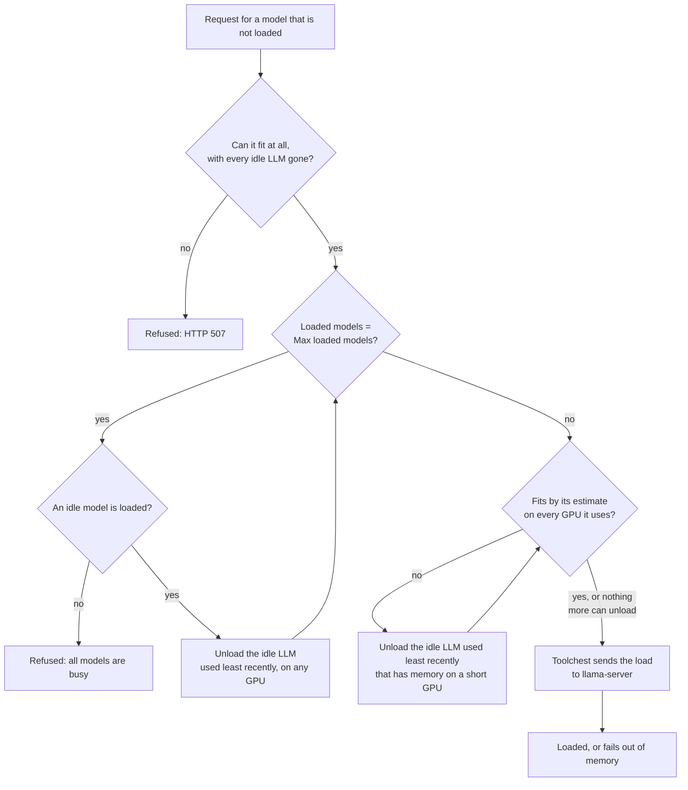
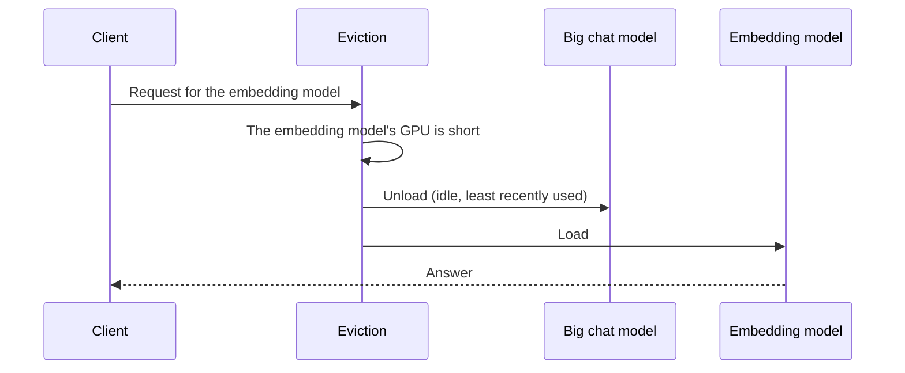
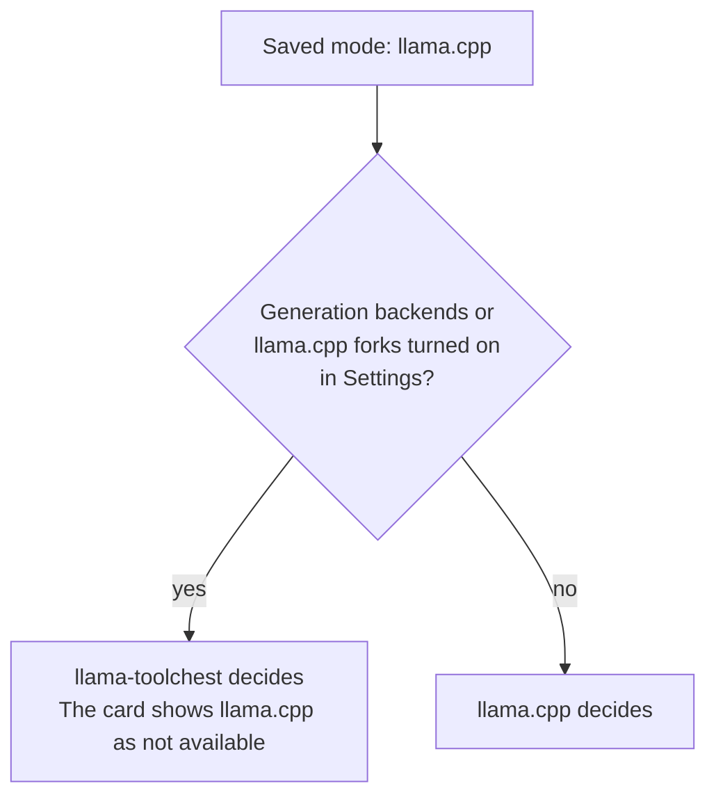

# Eviction modes

## What eviction does { #what }

Eviction is how toolchest makes room on a GPU for a new model. When a model does not fit, something that is loaded must unload first. The eviction mode decides who chooses, and what unloads.

## Modes { #modes }

| Mode | Who decides | Generation models | What happens |
| --- | --- | --- | --- |
| **Off** | The llama-server router, by count | Yes | The router keeps up to *Max loaded models*, of any size. At the limit, the model used least recently unloads. On a GPU with a generation reservation, toolchest refuses an LLM that does not fit beside it (HTTP 507). Other GPUs are not checked: a model that does not fit there fails to load. |
| **llama.cpp** | The llama-server router, by VRAM | No | Idle models unload, least recently used first, until the new model fits. The router keeps the largest [GPU memory margin](memory-margin.md) free on each GPU. Needs llama.cpp b11930 or newer. An older build unloads by count, as in Off. |
| **llama-toolchest** | Toolchest, by VRAM | Yes | Idle LLMs unload, least recently used first, on the GPUs that are short, until the new model fits by its estimate. Generation reservations stay free, unless [take turns](taking-turns.md#take-turns) is on. Works with any build. |

The diagrams below show what each mode does with a new load.

### Off { #off }

The router does not check VRAM in this mode. Set *Max loaded models* to a number of models that fits. `1` means one model at a time.

### llama.cpp { #llamacpp }

The router gets one margin for all GPUs: the largest margin of any GPU. It reads the margin when it starts.

### llama-toolchest { #toolchest }

!!! note "Since v2.51.0"
    Toolchest unloads idle LLMs by VRAM in this mode, and keeps several models loaded with generation backends on.

Toolchest plans with the estimate of each model, the [GPU memory margin](memory-margin.md) of each GPU, and the [generation reservations](reservations.md). It unloads only on the GPUs that are short, so models on other GPUs stay loaded.

If the generation reservations are still in the way, toolchest refuses the load with HTTP 507. With [take turns](taking-turns.md#take-turns) on, it stops idle backends instead.

When nothing more can unload, toolchest still sends the load. Then llama-server decides if the model fits.

## Rules in every mode { #always }

- A model that answers a request never unloads.
- *Max loaded models* is always an upper limit. `0` means no limit.
- Autotune and Autoconfigure test loads use one model at a time. Benchmarks do too, except in Off mode: there the benchmark router keeps up to *Max loaded models*.

## Small models stay { #small-models }

With llama.cpp or llama-toolchest, embedding and reranking models stay loaded beside a chat model while they fit.

A small model can unload a big one. This happens when the big model leaves too little room on a GPU that the small model uses:

To keep both loaded, give the big model a smaller context. Then it leaves room for the small model.

## When llama.cpp gives way { #gives-way }

The router knows only its own models. It cannot see the VRAM of generation backends or llama.cpp forks. So the llama.cpp mode cannot run with them.

This depends on the switches in Settings, not on running instances. Your llama.cpp choice stays saved. When generation backends and forks are off again, llama.cpp decides again.

## Split Mode tensor { #split-tensor }

The router cannot see the memory of a model with Split Mode `tensor`. So with llama.cpp, such a load can fail out of memory. Use llama-toolchest, or Split Mode `layer`.

## Changing the mode { #change }

!!! note "Since v2.52.0"
    One Eviction card in Settings holds all the unload settings.

Set the mode in Settings → Eviction (`/settings#eviction`). The Server tab shows the mode in effect.

A new mode applies at the next server start. The Eviction card has a *Restart server* button for this. The *take turns* switch applies at once.

## Related { #related }

- [How toolchest shares a GPU](index.md)
- [GPU memory margin](memory-margin.md)
- [Generation reservations](reservations.md)
- [LLMs and generation backends on one GPU](taking-turns.md)
- [Settings](../guides/settings.md)
