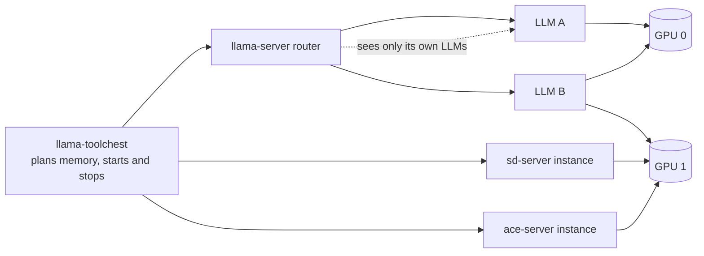

# How toolchest shares a GPU

A GPU has a fixed amount of VRAM. LLMs, generation backends, the desktop and other programs all need part of it. These pages explain how toolchest decides what can load, and what must make room.

## The parts { #parts }

Three kinds of program use the GPUs. Toolchest starts and stops all of them.

- **llama-server** runs the LLMs: chat models, embedding models and reranking models. Its router loads a model on the first request for it, and unloads models to make room.
- **Generation backends** make images, videos and music: `sd-server` of stable-diffusion.cpp and `ace-server` of acestep.cpp. Each instance is one backend process with one model set, on one GPU.
- **llama.cpp forks** run one model each, next to the router. They are experimental.

The router sees only the memory of its own LLMs. It cannot see the generation backends or the forks. Toolchest sees all of them, and the memory that the GPU driver reports. This is why toolchest, not the router, must decide when generation backends are on. See [When llama.cpp gives way](eviction.md#gives-way).

## What fills a GPU { #what-fills }

When toolchest plans a load, it counts these parts on each GPU:

- **Desktop and other programs:** the use that the GPU reports, apart from toolchest's own programs.
- **LLMs:** for each loaded model, its weights, its KV cache and its buffers.
- **Generation reservations:** the VRAM that each generation instance needs for a job. Toolchest keeps this room free, also while the backend waits. See [Generation reservations](reservations.md).
- **The GPU memory margin:** VRAM that toolchest always keeps free, for llama.cpp's working memory and the driver. See [GPU memory margin](memory-margin.md).

A new model can load when its estimate fits in what is left. When it does not fit, [eviction](eviction.md) decides what makes room.

## Where to go next { #next }

- [Eviction modes](eviction.md): who unloads what, and when.
- [GPU memory margin](memory-margin.md): the free VRAM that toolchest keeps on each GPU.
- [Generation reservations](reservations.md): why generation backends need room that stays free.
- [LLMs and generation backends on one GPU](taking-turns.md): jobs and chat on one GPU, and how they take turns.
