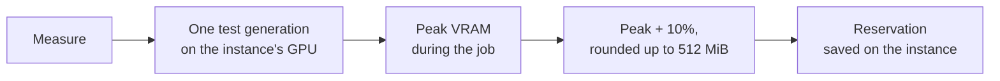

# Generation reservations

## What a reservation is { #what }

A reservation is the VRAM that one generation instance needs for a job. Toolchest measures it once for each instance, on the GPU of that instance.

A generation backend holds almost no VRAM while it waits. It takes its memory, often 10 to 20 GB, only when a job starts. Without a reservation, an LLM could load into that free room, and the next job would run out of memory. The reservation keeps the room free.

With no generation backends, there are no reservations.

## How Measure sets it { #measure }

*Start* on an instance that is not measured offers to measure it first.

- **Edits:** sets that edit images also measure an edit, because an edit can need more memory than an image.
- **Video sizes:** choose a size: Short, Medium, Full or custom. The instance then refuses larger videos.
- **Video test:** a video test runs one sampling step (one per expert for Wan2.2 A14B) and the whole decode. The peak is in the decode; the other steps only add time. After the instance makes a real video, its row shows how long it took.
- **Predicted sizes:** after two sizes are measured, the Measure dialog shows for each other size what it should need, and if it fits the card. The prediction is a line through the two measurements: memory grows with frames × width × height. Near the card limit, sd.cpp can decode in parts, which bends the line. So only Measure grants a size.
- **Measure inside a budget:** *Measure inside* sets a budget smaller than the whole room, to leave space for other models. sd.cpp then keeps weights in system RAM and decodes in parts, so videos are slower. The instance keeps that budget after.
- **When Measure stops:** when the size needs more than the card has, or when the test stops making progress: the GPU idle and the backend silent for 5 minutes, as a stuck tiled decode on a Radeon card does. It says how far it got.

## Planned, not held { #planned }

A reservation is planned, not held. The backend does not take the memory while it waits. Instead, toolchest's planner keeps the room free when it plans an LLM. It also keeps the [GPU memory margin](memory-margin.md) free.

This bar shows one 32 GB R9700 with two instances. The figures are from the [measured reservations](../reference/measured-reservations.md):

--8<-- "assets/diagrams/vram-reservations.svg"

The room for LLMs is the card's memory, less what the desktop and other programs use, less the margin, less the reservations. Toolchest reads the desktop use from the GPU, so the room is different on each machine.

- An LLM load that would crowd out a reservation is refused. The API answers HTTP 507, and *Load* shows an error. Benchmarks and Autotune are refused too.
- An enabled instance keeps its reservation while it is stopped. With [take turns](taking-turns.md#take-turns) on, this is different: then only running and locked instances count.
- Autoconfigure plans an LLM beside the reservations. With take turns on, *Use the whole GPUs, split evenly* plans it on the whole cards instead. Loading it then stops the backends in its way.

## Loads that toolchest cannot check { #unchecked }

The chat page of llama-server (port 8080) loads models without toolchest. So toolchest cannot check them against the reservations. On a GPU with reservations, load models from the Models page or the API.

## Text encoders on the CPU { #te-cpu }

All catalog image and video sets except SDXL run their text encoder on the CPU (`--backend te=cpu`). This makes the reservations smaller: on the R9700 it saved 4–5.5 GiB per image set at no real cost. The [reference page](../reference/measured-reservations.md#notes) has the figures for video sets.

## Measure again { #remeasure }

An instance measured before its set settings or files changed shows *Measured with other files or settings*. Measure it again: it can need more or less memory now. Changes made with *Edit*, other than auto-start, clear the reservation.

## Related { #related }

- [How toolchest shares a GPU](index.md)
- [LLMs and generation backends on one GPU](taking-turns.md)
- [Measured reservations](../reference/measured-reservations.md)
- [Image, video and music generation](../guides/generation.md)
