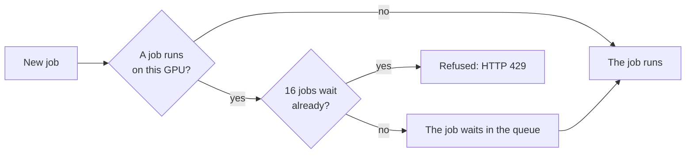
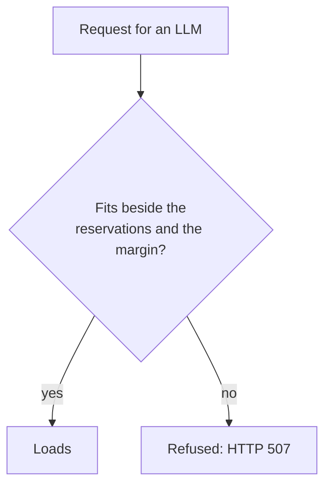
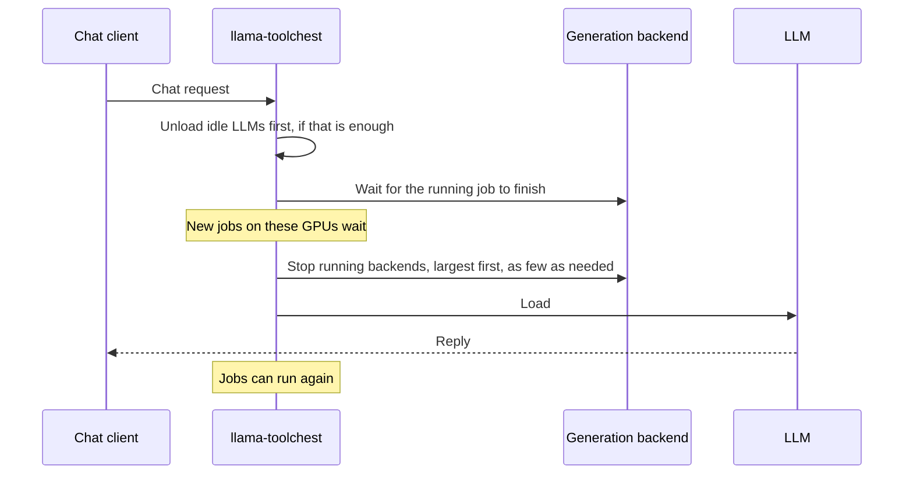
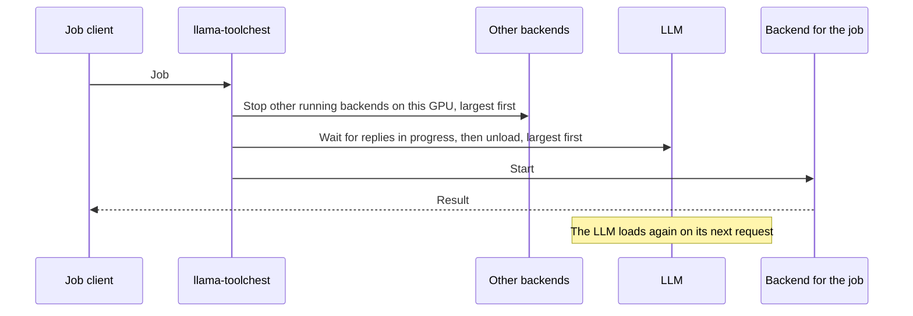

# LLMs and generation backends on one GPU

## Jobs and chat on one GPU { #sharing }

Jobs and chat on one GPU slow each other. On one R9700, images were 2.3× slower, songs 2.8× slower, and chat went from 45 to 11–20 tokens/s. So generation jobs take turns:

- One job runs on each GPU. Up to 16 more wait.
- Benchmarks, Autotune and Autoconfigure also wait for a running job. Then they keep the GPU until they finish.
- Jobs from the own web page of a backend skip the queue.
- Chat does not wait for jobs. There are two exceptions, both with [take turns](#take-turns) on: a chat that must first load its LLM waits for the running job, and a chat waits while its LLM unloads for a job.

Jobs on separate GPUs run at full speed if the LLM is not split onto those GPUs. To keep them apart, set the LLM's GPU Assignment to its own card, or clear the generation GPU in Autoconfigure.

## Default: reservations always count { #default }

By default, toolchest refuses an LLM that does not fit beside the reservations. This is also how it works with eviction Off.

Each enabled instance keeps its reservation, also while it is stopped.

## Taking turns { #take-turns }

With generation backends on and llama-toolchest in effect, the Eviction card has one more switch: *LLMs and backends can take turns on a GPU*. With it on, the newest request gets the GPU. Chat and jobs on one GPU swap it each time, with a reload of seconds to a minute.

Only running instances count, and locked instances. A stopped instance that is not locked has no reservation.

**A chat request for an LLM that does not fit:**

**A job for a stopped backend:**

"Largest" means the instance or LLM with the most memory on that GPU.

## Lock an instance { #lock }

*Lock* an instance on the Server page, so that it never stops this way. Its reservation always counts, also while it is stopped.

## Keep the prompt cache { #prompt-cache }

*Keep the LLM's prompt cache* saves conversations to disk before toolchest unloads an LLM. It restores them when toolchest loads the LLM again. Without it, the LLM must read each conversation again.

- It works with take turns on.
- It saves conversations of 1024 tokens or more.
- In one test, a 26,600-token conversation took 21.4 s to read again. Saving it took 0.5 s, and restoring it 0.2 s.
- Restart the router after you turn it on.

## What never stops backends { #never }

Benchmarks and Autotune never stop backends. Stop the backend first.

The test load of Autoconfigure is different. With take turns on, it stops the backends in its way.

## Related { #related }

- [How toolchest shares a GPU](index.md)
- [Eviction modes](eviction.md)
- [Generation reservations](reservations.md)
- [Image, video and music generation](../guides/generation.md)
