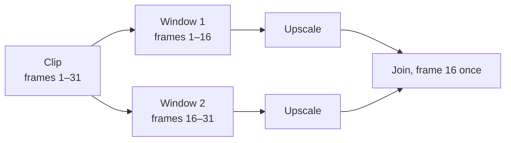

# Image, video and music generation

Image and video generation (`sd-server` of stable-diffusion.cpp) and music (`ace-server` of acestep.cpp) can run next to llama-server. They are off until you turn them on.

1. **Turn on** *Generation backends* in Settings (`/settings`).
2. **Build** stable-diffusion.cpp and/or acestep.cpp on Builds (`/builds`) (ROCm, CUDA, Vulkan in host installs, or Metal on a Mac).
3. **Get a model set.** A set is the files one model needs, and the settings it runs with.
    - **Download one** with *Get generation models* on Download Models (`/models/browse?open=generation`). Files go in the `gen-models` folder of the models folder. Video upscaler sets (RelayVSR, SeedVR2) carry the *video* tag.
    - **See how a set runs:** press *Details* on a catalog set or on a set on Models (`/models`). It shows each file, each setting with the reason for it, and the command that toolchest starts. Values in angle brackets, such as `<port>`, are set for each instance.
    - **Use your own files:** press *Add a custom set* on Models (`/models`). Choose the backend and the recipe. The recipe list comes from stable-diffusion.cpp's own recipe files (see [Where recipes come from](#recipes)). It has three groups: the recipes the catalog uses, the other recipes, and the recipes llama-toolchest cannot run. These last ones are greyed, and each shows why, for example a file or an input that llama-toolchest cannot pass to sd-server. Under the list, the form shows the chosen recipe's description from stable-diffusion.cpp, when it has one. The form then shows one field for each file the recipe needs. Type part of a file name to see matching files in the models folder, or paste a Hugging Face file link to download the file (see [Download files for a custom set](#custom-set-downloads)). Toolchest checks that each file exists and is a model file. It never deletes the files you give as paths. A new set's extra launch arguments and test size start from the recipe's own defaults, such as its steps, CFG scale and sampler. sd-server uses a recipe's defaults only when it loads the recipe itself, and llama-toolchest gives it the files one by one, so the form writes them out as flags. Change or clear them as you need. When you choose another recipe, the fields you did not change take that recipe's defaults, and the ones you changed stay. A copy keeps the settings of the set it was copied from.
    - **Start from a known set:** in *Details*, press *Copy as custom set*. The form opens with the recipe, settings and sizes of that set. Files that are on this machine are filled in with their paths. A file that is not gets its Hugging Face link, so *Add set* downloads it. A LoRA file must be local, so for a missing LoRA the field shows the file name. Change what you need, then save. Use this for a different quantization, a fine-tune, or files you already have from ComfyUI.
    - **Video upscaler sets** (backend *Video upscaler*) take two files, a diffusion model and its VAE, and a *Script* in place of the recipe: RelayVSR or SeedVR2. See [Video upscaling](#video-upscaling).
    - **Change a custom set:** press *Edit*. Its name, backend and recipe stay; to change them, copy the set. Stop its instance first. After you change its files or settings, measure the instance again.
    - **Files in a container:** the models folder is `/data/models` inside the container. Toolchest cannot see other host folders. Put the files under the models folder, or mount their folder under it.
4. **Create an instance**: on Models (`/models`), under *Generation models*, press *New instance* and choose a build and GPU. It shows on Server (`/server`).
5. **Measure it.** One test generation records the peak VRAM. The reservation is that plus 10%, rounded up to 512 MiB. *Start* on an unmeasured instance offers to measure first. [Generation reservations](../gpu/reservations.md#measure) explains video sizes, edits, budgets and when Measure stops.
6. **Start it**, or turn on auto-start. Change it with *Edit* while it is stopped. Changes other than auto-start clear the reservation.

## Where recipes come from { #recipes }

A recipe is stable-diffusion.cpp's description of a model: which files it needs, and its default settings. Each stable-diffusion.cpp build keeps the recipe files of the commit it was built from. The custom set form uses the recipes of the newest build. When there is no build yet, or the newest one is older than this feature, it uses a copy built into llama-toolchest. So a new model that stable-diffusion.cpp adds can be used after the next build, without a llama-toolchest update.

An instance starts only on a build that knows its set's recipe. If you run a set on an older build that does not have the recipe, the start is refused and says so; choose a newer build for the instance. A set whose recipe the current list does not know is kept. *Details* shows a warning, and *Copy* and *Edit* still open it.

### Flags that newer builds removed { #removed-flags }

stable-diffusion.cpp master-1116 removed the launch flags for the high-noise expert of a Wan2.2 A14B pair, such as `--high-noise-cfg-scale` and `--high-noise-sampling-method`. `--high-noise-steps` and `--moe-boundary` are still there. sd-server still takes the same settings in each request, under `high_noise_sample_params`.

Older builds still need these flags, because without them the high-noise expert uses its own default of CFG 7. So the Wan2.2 A14B sets keep them, and toolchest also sends their values with every video request. When an instance starts, toolchest reads the build's `sd-server --help`. If the build does not list one of these flags, toolchest leaves the flag out of the launch, and the value in the request still reaches the high-noise expert. This matters for Wan2.2 T2V A14B, which uses CFG 4 on the high-noise expert and CFG 3 on the low-noise one. *Details* still shows the flags, and llama-toolchest's log says which ones went with the requests instead.

This covers `--high-noise-cfg-scale`, `--high-noise-img-cfg-scale`, `--high-noise-guidance`, `--high-noise-slg-scale`, `--high-noise-skip-layer-start`, `--high-noise-skip-layer-end`, `--high-noise-eta` and `--high-noise-sampling-method`, from a set's flags or an instance's extra flags. `--high-noise-skip-layers` is a list and is not sent; on a newer build it is left out, with a warning in the log. A request's own `extra.high_noise_sample_params` wins over the set's values, field by field.

## LTX-2.5 { #ltx-2-5 }

The LTX-2.5 distilled set is the newest LTX model from Lightricks. Like LTX-2.3, it makes video from text, a start image, or a start and an end image, with a sound track in WebM. Its text model is a version of Gemma 4 12B made for LTX, and Lightricks says it keeps hold of long prompts with several people, camera moves and lighting better than LTX-2.3 did.

That text model is only published as a 26 GB bf16 file. The set converts it to Q8_0 while it loads (`--tensor-type-rules`) and runs it on the CPU, so it needs about 13 GB of system RAM and the first load takes longer. Plan for about 42 GB of downloads in all.

LTX-2.5 needs stable-diffusion.cpp master-833 or newer. stable-diffusion.cpp does not support two LTX-2.5 features: multishot scenes, and choosing the length from the prompt. Always send `frames` or `seconds`, or the set's default length is used.

## Speech-to-video { #speech-to-video }

Wan2.2 S2V (the `wan22-s2v` recipe) makes the person in a picture speak or sing along with an audio track. A set for it needs one more file than the other Wan sets, the *Audio encoder* (wav2vec2 Large English), and it has the `start_image` and `audio` capabilities.

- **Both inputs are needed:** a `start_image` with the face, and an `audio` track as a WAV, MP3 or FLAC file. A job without one of them is refused.
- **Length:** with no `frames` or `seconds`, the video is as long as the audio. Audio that is longer than the set's limit is then refused. Send a length to cut it instead.
- **Frame rate:** the model always makes 16 fps. A different `fps` in a request is replaced, and the custom set form saves 16.
- **Sound:** sd-server builds from stable-diffusion.cpp 6cd0ef1 (2026-11-22) put the audio in the WebM. Older builds make a silent video; add the track yourself, as the [API page](../api.md#generation-api) shows.
- **Measure** sends a test picture and a test tone as long as the test video.

## Video upscaling { #video-upscaling }

A video upscaler set makes a clip larger and sharper. Unlike an image upscaler run on each frame, it looks at several frames at once, so the result stays steady from one frame to the next instead of flickering. Two models are supported, both from stable-diffusion.cpp:

- **RelayVSR**, as ×2 and ×4 catalog sets. It works on windows of frames that share one frame with the next window, so the joins are smooth. It has a fast CUDA path on NVIDIA cards; ROCm and Vulkan use a slower tiled path.
- **SeedVR2**, as the 3B catalog set. It restores detail well. By default it works on one frame at a time to save memory; a larger window gives smoother motion. The 7B Sharp model works as a custom set (see [Custom sets](#video-upscaling-custom)).

Clients send clips to [`/v1/videos/upscale/jobs`](../api.md#generation-api). There is no page in the app for it.

What it takes, for an 81-frame 832×480 clip (more in [Measured reservations](../reference/measured-reservations.md#table)):

| Set | Radeon AI PRO R9700 (32 GB, ROCm) | RTX A4000 (16 GB, CUDA) |
| --- | --- | --- |
| RelayVSR ×2 | ~11 GiB, ~70 s | ~10 GiB, ~30 s |
| RelayVSR ×4 | ~27 GiB, ~5 min | Does not fit; 512×288 does (~12 GiB) |
| SeedVR2 3B, window 1 | ~11 GiB, ~4 min | ~11 GiB, ~5 min |
| SeedVR2 3B, window 5 | ~26 GiB, ~12 min | Does not fit |

RelayVSR is fast on NVIDIA cards (a fused CUDA kernel) and slower, but working, on Radeon.

### What you need { #video-upscaling-build }

Both models run as DGL scripts (stable-diffusion.cpp's graph language), which came in stable-diffusion.cpp master-1116. An instance on an older build does not start; it says *video upscaler sets need stable-diffusion.cpp master-1116 or newer (DGL)*, and the Server page shows the same note under the instance. Build a newer stable-diffusion.cpp on Builds, or pick a newer build for the instance.

Toolchest sends its own two scripts to sd-server with each job. You do not need to set up anything else.

### Clip formats { #video-upscaling-formats }

The upscaler reads what stable-diffusion.cpp reads, and toolchest checks a clip before it gives it to the GPU:

- **AVI** with 24-bit RGB or MJPEG video, and PCM or 32-bit float audio (or none).
- **WebM** with VP8 video where every frame is a keyframe, and PCM16 audio or none. This is what toolchest's own video jobs write, so their videos can go straight into the upscaler.
- **WebP**, animated (all frames the same length) or still.

MP4 is not accepted, and neither are VP9, ordinary VP8 WebM with in-between frames, or AAC and Opus audio. The error says what was wrong. To convert a clip on the client, MJPEG AVI is the simplest target:

```bash
ffmpeg -i in.mp4 -c:v mjpeg -q:v 3 -c:a pcm_s16le out.avi
```

The result comes back as `webm` (the default; it has no sound) or `avi` (MJPEG with the clip's sound). When a clip with sound is sent for webm output, the job says `audio_dropped`.

### Limits { #video-upscaling-limits }

stable-diffusion.cpp holds the whole decoded clip in memory, and refuses more than 256 MiB of it: 3 bytes × width × height × frames. That is about:

| Clip size | Most frames |
| --- | --- |
| 832×480 | 224 |
| 1280×720 | 97 |
| 1920×1080 | 43 |

Split longer clips on the client and upscale the parts. The joined result may be up to 4 GiB, and one window has its own limit (1 GiB for RelayVSR, 256 MiB of float data for SeedVR2). The error gives a window size that fits.

After [Measure](#video-upscaling-measure), the instance also refuses clips larger than the one it was measured with. Width, height, frame count and window are each checked on their own, so a portrait clip needs a portrait measurement.

### Window size { #video-upscaling-window }

`window_size` is how many frames the model looks at together. More frames give smoother motion and use more GPU memory.

- **RelayVSR:** 2 to 32, default 16. Each window shares its last frame with the next one:



- **SeedVR2:** 1, or 5, 9, 13 and so on up to 33 (the model pads windows to 4n+1 frames, so other sizes would waste work). The default, 1, treats each frame on its own. Larger windows smooth the motion, but the joins between windows can show.

### Custom sets { #video-upscaling-custom }

In *Add a custom set*, choose the *Video upscaler* backend, then the *Script*, the two files and the scale. The files must match the script, and for RelayVSR the scale must match the files: the ×2 and ×4 files are different models, and the form refuses a mismatch when the file name says which one it is. SeedVR2 can make a clip 2, 3 or 4 times larger with the same files.

For SeedVR2 7B Sharp, use `diffusion_models/seedvr2_7b_sharp_int8_convrot.safetensors` (8.3 GB) and `vae/seedvr2_ema_vae_fp16.safetensors` from [Comfy-Org/SeedVR2](https://huggingface.co/Comfy-Org/SeedVR2). That repository also has fp16, fp8, mxfp8 and nvfp4 variants, but stable-diffusion.cpp's guide names only the int8_convrot files. On a 16 GiB RTX A4000 the 7B model peaked at 14.0 GiB for 33 frames at 832×480 and took 155 s for that clip, about 1.2 times as long per frame as the 3B set. Memory grows with the frame count, so on a 16 GiB card measure it at the clip length you need.

### Measure { #video-upscaling-measure }

*Measure* asks for a test clip: its width and height before scaling (multiples of 16), its frame count, and the window size. Toolchest writes a clip of that size, upscales it once with nothing else on the GPU, and reserves the peak plus 10%. Clips up to that size are then allowed. The default is 832×480 with 81 frames, five seconds of Wan video, with the script's default window.

The frame count matters as well as the size: RelayVSR ×2 at 832×480 needed 6.8 GiB for 33 frames and 8.6 GiB for 81 on an RTX A4000. Measure the longest clip you plan to send.

On stable-diffusion.cpp master-1129 and newer, a video upscaler instance runs inside `--max-vram`, as image and video instances do. Measure runs the test clip inside the room the card can give the instance, and the instance then keeps to its reservation. If a step needs more than the limit, sd.cpp keeps part of the weights in system RAM, which is a little slower.

Older builds run video upscalers without `--max-vram`. Their DGL engine plans for far more memory than the run uses and fails under a limit (*diffusion output shape [] does not match input*), even when the limit is above the measured peak. On those builds, as for the ESRGAN upscaler and ace-server, the reservation is only used for planning. When a clip does not fit, the job fails with *sd.cpp ran out of GPU memory for this clip size or window*. From master-1129, sd.cpp's part of that message also says which step ran short and how much memory it needed and had.

### Cancelling { #video-upscaling-cancel }

A job still waiting in the queue is simply taken out of it. For a running job, toolchest asks stable-diffusion.cpp to cancel it, which works from master-1132. sd.cpp stops at its next cancellation check, so the step it is on may finish first; toolchest waits up to 30 seconds for that, and the instance stays loaded for the next job.

Older builds cannot stop a running upscale, and a job that is still running after 30 seconds is treated the same way: toolchest stops the instance to free the GPU. The next job starts it again, which means loading the weights again.

## Download files for a custom set { #custom-set-downloads }

A file field of the custom set form takes a path in the models folder, or a link to one file on Hugging Face. One set can have both local files and links. LoRA files must be local files.

To choose a file, press *Browse* next to the field. The dialog shows:

- **Suggested repositories:** the repository the recipe links to, and the repositories that catalog sets use for this slot. Press one to list its files.
- **Files that catalog sets use for this slot**, for example the text encoder of the FLUX.2 klein set when you make a FLUX.2 klein set of your own.
- **The files of one repository**, with their sizes. Type any repository (`org/name`) or paste a Hugging Face link, and press *List files*. The list shows model files only (`.safetensors`, `.gguf`, `.ckpt`, `.pt`, `.pth`; `.json` for the tokenizer). *Show all files* shows the rest. A repository in the Diffusers layout gets a note: sd-server needs one combined file, so look for a single-file or GGUF version.

*Use* writes the file's link into the field. You can also paste a link yourself: copy it from the file's page on Hugging Face, for example `https://huggingface.co/stabilityai/sd-turbo/blob/main/sd_turbo.safetensors`. Links with `/resolve/` in place of `/blob/` work too.

A copy of a set (*Copy as custom set*) fills each file that is not on this machine with its Hugging Face link. *Add set* then downloads only those files. To change one file first, for example to a different quantization, press *Browse* next to it.

Above *Add set*, the form shows how much the links download and how much space is free. It changes when a field changes.

When you press *Add set*:

1. Toolchest asks Hugging Face for the commit that the link's branch points to now, and the file's size. The set keeps that commit, so a resumed download gets the same file even if the repository changes later.
2. A file that is already in the `gen-models` folder at the same size is used as it is. A catalog set may have downloaded it before.
3. If the other files do not fit in the free space of the models folder, the set is not added. The message gives both sizes.
4. Toolchest saves the set and starts the downloads. The set's row on Models shows the progress. An instance cannot start until all the files are there.

When a file finishes, toolchest checks that it is a model file (GGUF, safetensors or PyTorch; a JSON file for the tokenizer). If it is not, for example a README or an HTML page, toolchest deletes it. The row then shows *Incomplete (wrong file)*, and its tooltip gives the reason. Edit the set to give another file. Saving the edit starts its download, so you do not need *Resume*.

*Resume* also continues a download that stopped, for example after a restart. It downloads from the commit the set keeps.

When you delete the set, toolchest deletes the files it downloaded for it, and the folders that are then empty, but not the files another set still uses. It never deletes files you gave as paths.

A gated model needs a Hugging Face token in Settings, and you must agree to the model's terms on Hugging Face first. Browse lists a gated repository's files even without access, so *Add set* checks each file to download first. If the token cannot download it, the set is not added, and the message (also in the line above *Add set*) says what to do. See [HuggingFace token](settings.md#hf-token).

## GPU memory { #gpu-memory }

Generation backends share the GPUs with the LLMs. These pages explain how:

- [Generation reservations](../gpu/reservations.md): the room that each instance keeps free, and how Measure sets it.
- [LLMs and generation backends on one GPU](../gpu/taking-turns.md): the job queue, and how LLMs and backends take turns when both do not fit.
- [Measured reservations](../reference/measured-reservations.md): what each catalog set needed on two test cards.
